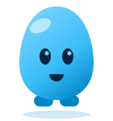
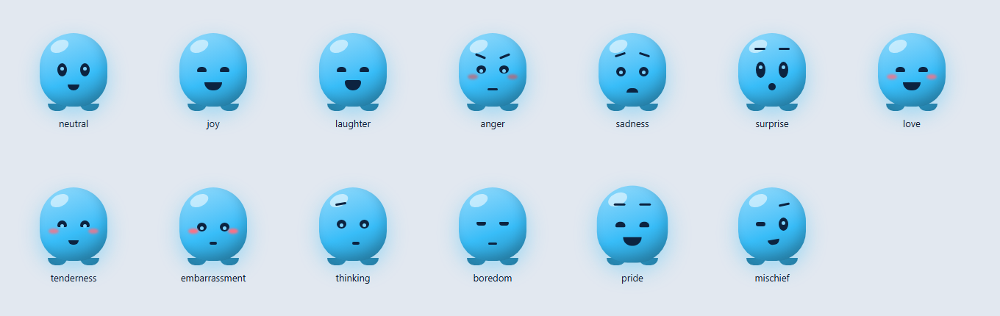

<p align="center">
  
</p>

<h1 align="center">Oz</h1>

<p align="center">
  <strong>A little egg that lives on your Windows desktop.</strong><br>
  It listens, talks back out loud, looks at your screen when you ask it to,<br>
  and only touches your windows with your permission.
</p>

<p align="center">
  
  
  
  
</p>
<p align="center">
  
  
  
  <a href="LICENSE"></a>
</p>

<p align="center">
  <a href="#-quick-start">Quick start</a> ·
  <a href="#-features">Features</a> ·
  <a href="#-modules">Modules</a> ·
  <a href="#-the-trust-contract">Trust contract</a> ·
  <a href="docs/architecture.md">Architecture</a> ·
  <a href="#️-roadmap">Roadmap</a>
</p>

---

## 🥚 Why Oz

Assistants live in a window you have to open. Oz **lives on your desktop**: a small animated egg in a transparent overlay that wanders around, sits down, listens when you talk to it and answers out loud.

It understands what you say **with a real language model, no keywords**: "what's open right now?", "close Spotify for me", "what do you see on my screen?". But it can do **nothing** you haven't allowed: every permission is checked in Rust code, never in a prompt.

## ✨ Features

| | |
|---|---|
| 🎙️ **Voice first** | One Gemini Live session hears you, calls tools and answers out loud: first sound in under a second. Click the egg or press a global hotkey; talk over Oz to interrupt it. Other apps are muted while you talk, then restored. |
| 💬 **Starts the conversation** | When you come back, in the morning or after a long stretch, Gemini decides whether Oz has something worth saying. It calls you by name, or raises its hand if you look busy. "Not now" mutes it. |
| 🧠 **LLM understanding** | Gemini understands the request however it's phrased and calls tools (function calling). No keyword router. |
| 😄 **Emotions** | Its face changes (12 expressions: joy, laughter, anger, surprise, embarrassment, pride…) and emoji bubbles float up from it. Gemini chooses the feeling, alongside its reply. |
| 👀 **Vision** | Oz captures an allowed window and describes it. **Watch with me**: it follows one allowed window live while you talk. After "stop watching", no capture without a tap from you. |
| 🧩 **Toolsets and modules** | Tools are grouped in toolsets you switch on and off, Hermes Agent style. Install **modules** (PowerShell tools + skills) from a git link or a folder, after reading their code. |
| 🛠️ **Grows its own toolbox** | A Pi-style kernel (read, write, edit files in its own workshop; run PowerShell with your approval) and tools Oz writes itself, each with a test that runs only after you approve it. |
| 📚 **Skills** | Written procedures (`SKILL.md`) you add from the panel: they tell Oz *how* to go about something, and Oz acts with its tools. It opens one when the situation matches, and drafts new ones from its repeated misses for you to accept. |
| 🗂️ **Memory** | Lasting facts from your conversations, saved at the end of each one; a new fact that contradicts an old one replaces it. Deletable one by one. |
| 🐣 **A living egg** | Strolls, poses, tricks (zigzag, spins, flips, dance), named places ("go home"), no-go zones, movement modes (free, fixed, docked, focus), in front of or behind windows, any color and a texture. |
| 👋 **Yours** | No name in the code: Oz asks your first name on first launch (or reads it from *Settings*) and uses it everywhere, along with your local date and time. |
| 🎛️ **Admin panel** | Sidebar app in the egg's colors, light and dark: chat, settings, memory, skills, tools and modules, permissions with the live list of open windows, zones, activity log, models. |

<p align="center">
  
</p>

### Toolsets

Each group can be switched off in the **Tools** tab: Gemini no longer sees it and the code refuses its tools.

| Toolset | Tools | Permission |
|---|---|---|
| Windows | `list_windows`, `close_window`, `focus_window` | listing: none (sanctuaries stay invisible) · close, focus: *Act* |
| Vision | `look_at_window`, `watch_with_me` | *Look*, checked on every frame |
| Body | `move`, `set_pose`, `do_trick`, `places`, `no_go_zone`, `set_layer`, `set_movement_mode` | — |
| Expression | `express_emotion`, `customize_egg` | — |
| Conversation (always on) | `set_owner_name`, `end_conversation`, `not_now` | — |
| Sound | `volume` | — |
| Skill reading | `read_skill` (the action that opens a skill, a written procedure) | — |
| Kernel | `read_file`, `write_file`, `edit_file`, `run_command` | writes only in its workshop; reading elsewhere and any non-read-only command ask first |
| Workshop | `create_tool`, `use_tool` | approval for the test and after any change |
| *Each installed module* | its own tools | its code is reviewed at install; a changed script asks again |

Tool and parameter names are in English; their descriptions are in French, the language Oz speaks by default (chosen in *Settings*).

## 🧩 Modules

A module adds tools to Oz without touching its code: a folder with a `module.json`, PowerShell scripts and optional skills.

```text
window-sizes/
├── module.json      name, version, tools (JSON Schema parameters) and their scripts
├── window.ps1       gets $OzArgs (arguments) and $OzTool (the tool called)
└── skills/arranger-fenetres/SKILL.md
```

Install from the **Tools** tab with a git URL or a local path. Nothing runs before you have read the code of every script and clicked *Install*. Try the example: [`examples/modules/window-sizes`](examples/modules/window-sizes) (minimize, maximize, restore a window). Format and rules: [docs/modules.md](docs/modules.md).

## 🔐 The trust contract

> [!IMPORTANT]
> The model **proposes**, the code **decides**. No LLM can bypass a permission: they are enforced by the *broker*, in Rust.

- **Nothing without consent.** An unknown window triggers an access request on the egg: *Look*, *Act*, *Not now* or *Sanctuary*.
- **Sanctuaries are inviolable.** A sanctuary window doesn't exist for Oz: never listed, never seen, never touched. It is simply "not found".
- **Five levels.** Sanctuary · No access · Look · Act · Trust, per app or per window.
- **Receipts.** Everything Oz has seen, done or been granted is recorded in the activity log.
- **Secrets in the vault.** The Gemini key lives in Windows Credential Manager, never in a file.
- **Code you've read.** Commands, Oz-made tools and installed modules only run after you've seen their code; any change asks again.

Details: [docs/permissions.md](docs/permissions.md).

## 🚀 Quick start

**Requirements:** Windows 10 or 11, [Node.js](https://nodejs.org), [Rust](https://rustup.rs) (stable) and the [Tauri 2 prerequisites for Windows](https://v2.tauri.app/start/prerequisites/).

```bash
git clone https://github.com/julienawonga/oz.git
cd oz/app          # package.json lives in app/, not at the root
npm install
npm run tauri dev
```

On first launch, open the admin panel, **Models** tab, pick the brain and enter your Gemini key.

> [!TIP]
> To test the voice without the app: `cd app/src-tauri && cargo run --example voice_probe [file.wav]`.

## 🤖 Models

| Provider | Chat | Tools | Voice | Vision |
|---|:---:|:---:|:---:|:---:|
| **Gemini** | ✅ streaming | ✅ function calling | ✅ Gemini Live | ✅ |
| **Ollama** (local) | ✅ streaming | 🚧 coming soon | — | — |

## 🏗️ Architecture

```
  mic ──► Gemini Live (conversation) ──► Oz's voice ──► egg (TS)
                    │
                    ▼
                  tools ──► broker (Rust) ──► Win32
                    ▲            ▲
  initiative ───────┘   permissions
  (signals + Gemini judge)
```

```
app/
├── src/egg/        the egg: window, bubble, voice, emotions, initiative, movement, tricks, access requests
├── src/panel/      the admin panel, one module per tab
└── src-tauri/src/  Rust: broker, toolsets registry, tools, kernel, modules, skills, brain, voice, volume,
                    initiative, watch, vision, memory, prefs, places, zones, journal
docs/               architecture, permissions, voice, modules, development, roadmap
examples/modules/   an installable example module
```

## 🧪 Tests

```bash
cd app/src-tauri && cargo test     # broker, toolsets registry, modules, skills, kernel allowlist
cd .. && npx tsc --noEmit          # front-end type check
```

## 🗺️ Roadmap

**Done**

- [x] Real-time voice in one Gemini Live session, tools included; interrupt by voice
- [x] Gemini tools instead of keywords; Oz starts the conversation on its own
- [x] Vision and "watch with me", behind per-window permissions and sanctuaries
- [x] Emotions on its face, movement modes, colors and textures
- [x] Memory saved after each conversation, contradictions replaced
- [x] Toolsets, installable modules, skills, Pi-style kernel and tools Oz writes itself

**Next**

- [ ] **MCP servers** as toolsets: the whole MCP ecosystem, each call still behind the broker
- [ ] **Standard skills** ([agentskills.io](https://agentskills.io), Hermes-compatible): import community skills
- [ ] **Hooks** for modules: start and end of a conversation, before a reply
- [ ] Oz reacts on its own (an emotion, a remark) to what it sees or hears
- [ ] Tools for local models (Ollama)

**Later**

- [ ] Recognize its owner's voice (local voice print) to ignore other voices
- [ ] Wake word or push-to-talk
- [ ] macOS and Linux

Details (in French): [docs/roadmap.md](docs/roadmap.md). Ideas and pull requests are welcome.

## 📚 Documentation

The detailed docs are in French.

- [Architecture](docs/architecture.md): modules, message flow, events.
- [Permissions](docs/permissions.md): levels, rules, broker behavior.
- [Voice](docs/voix.md): mic pipeline, transcription, playback, interruption, ducking.
- [Modules](docs/modules.md): writing and installing a module.
- [Development](docs/developpement.md): conventions, tests, local data, troubleshooting.
- [Roadmap](docs/roadmap.md): done, next, later. Old design notes are in [docs/archive](docs/archive/).

<details>
<summary>Former name: Nid</summary>

The project used to be called Nid. On first launch, Oz picks up the data from the old folder and the API key from the old Credential Manager entry.
</details>

## 📄 License

[MIT](LICENSE) © 2026 Julien Awonga
