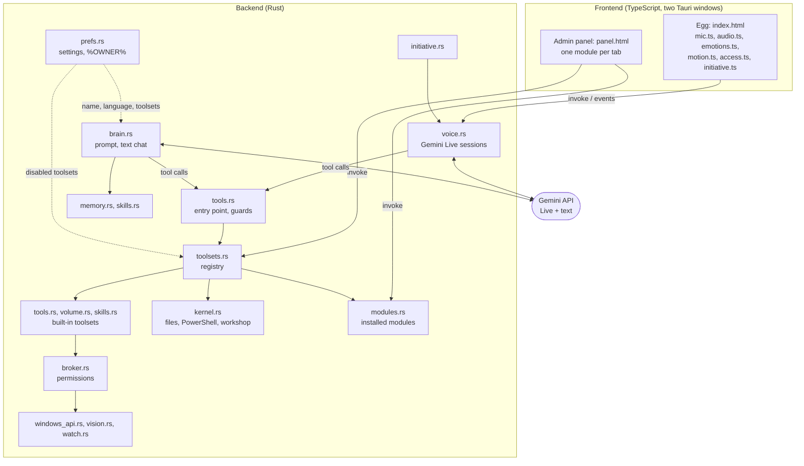

# Architecture

Deux fenêtres Tauri partagent le même backend Rust :

- **L'œuf** (`index.html`, label `oz`) : surcouche transparente de 360 × 720, toujours au premier plan. L'œuf est au milieu ; la place au-dessus et en dessous accueille la bulle. Hors de l'œuf et de la bulle, les clics traversent la fenêtre.
- **Le panneau** (`panel.html`, label `panel`) : administration.

Le frontend n'a aucune logique de sécurité. Il appelle des commandes Rust (`invoke`) et écoute des événements.

## Backend (`app/src-tauri/src/`)

| Module | Rôle |
|---|---|
| `lib.rs` | Déclare les modules, migre les anciennes données, enregistre les commandes, le raccourci global et la boucle d'initiative. |
| `broker.rs` | Permissions, demandes d'accès, exécution des actions sur les fenêtres. Contient les tests. |
| `toolsets.rs` | Registre des outils, rangés en toolsets (à la façon d'Hermes Agent) : rassemble les toolsets de chaque module, ne déclare à Gemini que les actifs, refuse les outils d'un toolset coupé. |
| `modules.rs` | Modules installables : préparation (git ou dossier), relecture, installation avec approbation du code des scripts, un toolset par module, skills livrés. Voir [modules.md](modules.md). |
| `tools.rs` | Toolsets natifs (Fenêtres, Vision, Corps, Expression, Conversation), point d'entrée `run` (garde-fous communs, journal) et exécution des outils natifs. |
| `brain.rs` | Chat écrit (Gemini en SSE avec outils), prompt d'Oz dans la langue choisie, clé API dans le coffre Windows. |
| `voice.rs` | Sessions Gemini Live (conversation et lecture), micro, consignes `live_prompt`. |
| `initiative.rs` | Oz engage la conversation : signaux, garde-fous, jugement par Gemini. |
| `prefs.rs` | Réglages : langue, raccourci du micro, transcription, initiative, interruption à la voix, mode de déplacement, devant/derrière les fenêtres, couleur et texture. |
| `skills.rs` | Skills (`skills/<id>/SKILL.md`) : liste dans les consignes, outil `read_skill`, relecture du journal qui propose des skills (toutes les 3 consolidations). |
| `kernel.rs` | Noyau à la Pi : fichiers de l'atelier, PowerShell avec accord, outils fabriqués par Oz (`create_tool`, `use_tool`), demandes d'accord et leur résultat renvoyé dans la conversation. |
| `volume.rs` | Volume du système et baisse automatique des autres applis pendant l'écoute (sessions audio Windows, Oz et ses processus WebView2 épargnés). |
| `places.rs` | Lieux nommés (« la maison »). |
| `memory.rs` | Faits durables, épisodes, souvenirs sur les fenêtres, consolidation par Gemini. |
| `vision.rs` | Capture d'une fenêtre autorisée et description ; résolution de fenêtre et contrôle du regard partagés (`lookable_window`, `can_look`). |
| `watch.rs` | « Regarde avec moi » : une image par seconde d'une fenêtre autorisée dans la session vocale. |
| `zones.rs` | Zones interdites à l'œuf. |
| `journal.rs` | Quittances : ce qu'Oz a vu, fait, demandé, et le texte des échanges vocaux. |
| `cursor.rs`, `windows_api.rs` | Curseur global et API Win32 (énumération, capture, fermeture, focus). |

Le client HTTP est partagé (`http_client()`, connexion 10 s, lecture 60 s) et les erreurs HTTP passent par `http_error()`, qui produit des messages lisibles.

## Frontend (`app/src/`)

`main.ts` est un point d'entrée mince. Tout est dans `egg/` :

| Module | Rôle |
|---|---|
| `state.ts` | État partagé : réflexion, voix, micro, réglages. |
| `window.ts` | Glisser-déposer, clic sur l'œuf, click-through, regard, clignement. |
| `mic.ts` | Ouverture du micro, détection de silence, interruption à la voix (double parole), baisse des autres applis, halo d'écoute. |
| `audio.ts` | Lecture de la voix (mesurée par un analyseur pour l'anti-écho), transcriptions dans la bulle, événements `oz://voice-*`. |
| `initiative.ts` | Mise en scène des prises de parole d'Oz (appeler, lever la main). |
| `intents.ts` | Actions du corps demandées par les outils (`oz://do`) : déplacement, lieux, pose, figures, fin de conversation. |
| `motion.ts` | Poses, balade, modes de déplacement (libre, fixe, bord, concentration), glissements, bornes de l'écran calculées sur l'œuf, zones interdites. |
| `figures.ts` | Figures : trajets (zigzag, cercle, huit, vague, spirale) et numéros sur place (toupie, salto, demi-tour, saut, danse). |
| `converse.ts` | Chat texte en streaming lu par la voix (panneau, reprise après permission). |
| `access.ts` | Badge et carte de demande : accès à une fenêtre, ou commande / outil qu'Oz veut lancer (code affiché). |
| `ui.ts` | Bulle (au-dessus ou sous l'œuf selon la place). |

Le panneau (`panel.html`, `panel.ts`, `panel.css` et `panel/`) a une barre latérale groupée : *Oz* (`chat`, `settings`, `memory`, `skills`, `toolsets`), *Confiance* (`perms`, `zones`, `journal`), *Système* (`brain`). Un module par onglet. Le pied de la barre rappelle le raccourci du micro. Couleur d'accent : le bleu de l'œuf ; thème clair ou sombre selon Windows ; sous 720 px de large, la barre ne garde que les icônes.

## Parcours d'une parole

1. Clic sur l'œuf ou raccourci : le micro streame vers la session Live « conversation ».
2. Gemini Live comprend la demande et, si besoin, appelle un outil.
3. `tools::run` exécute l'outil. Tout ce qui touche une fenêtre passe par le broker, qui vérifie le niveau d'accès ou lève une demande d'accès. Les outils du corps (déplacement, figures) émettent `oz://do` vers l'œuf.
4. Oz répond en audio, joué au fil de l'eau.
5. L'échange est rangé dans l'historique et le journal ; tous les 6 échanges, la conversation est consolidée en faits durables.

Un message tapé dans le panneau suit le même principe avec le cerveau texte (`chat`) : mêmes outils, mêmes permissions.

## Événements

| Événement | Émis par | Usage |
|---|---|---|
| `oz://do` | outils | Actions du corps : `move`, `goto`, `pose`, `figure`, `end`, `mute` (couper le son après sa phrase). |
| `oz://initiative` | initiative | Oz veut parler : manière, sujet, première phrase. |
| `oz://shortcut-mic` | raccourci global | Même effet qu'un clic sur l'œuf. |
| `oz://watch` | watch | Vue en direct active ou non : témoin sur l'œuf. |
| `oz://prefs-updated` | prefs | L'œuf relit ses réglages. |
| `oz://access-request` | broker | Affiche la demande d'accès sur l'œuf. |
| `oz://exec-request` | kernel | Commande, lecture de fichier ou test d'outil à valider sur l'œuf. |
| `oz://chat-line` | œuf | Reflète la conversation dans le panneau. |
| `oz://brain-updated` | panneau | L'œuf relit la config du cerveau. |
| `oz://voice-talk-audio`, `-talk-text`, `-user-text`, `oz://voice-talk-turn` | voice | Conversation vocale : voix d'Oz, transcriptions, fin d'échange. |
| `oz://voice-audio`, `-interrupted`, `-error`, `-turn-complete` | voice | Session de lecture et état des sessions. |

## Données locales

Tout est dans le dossier de données de l'application (`%APPDATA%\com.julienawonga.oz`) : `brain.json` (sans clé), `prefs.json`, `places.json`, `permissions.json`, `zones.json`, `journal.jsonl`, mémoire (`memories.json` et les faits et épisodes consolidés), `initiative-day.txt`, `skills/` (un dossier par skill), `atelier/` (fichiers d'Oz, et `atelier/outils/` pour ses outils fabriqués). La clé API est dans le Gestionnaire d'identifiants Windows, service `oz`, utilisateur `gemini_api_key`.

## Noyau et outils fabriqués

On parle à Oz et la transcription se trompe parfois : rien de risqué ne part sur une simple phrase. C'est le code qui décide, pas le modèle.

- **Écrire, modifier** : seulement dans l'atelier (chemin relatif, sans `..`).
- **Lire** : libre dans l'atelier ; ailleurs, accord de l'utilisateur.
- **Exécuter** : un enchaînement de cmdlets de lecture d'une courte liste (`Get-Process`, `Get-Date`, `Select-Object`…), sans variable, bloc ni redirection, passe seul. Tout le reste est affiché sur l'œuf et attend l'accord ; le résultat revient ensuite dans la conversation (`live_prompt`). Délai de 25 s, sortie tronquée.
- **Outils fabriqués** : `create_tool` enregistre un script PowerShell avec un test. Le test tourne après accord ; l'outil n'est adopté que s'il sort sans erreur et affiche le texte attendu. Le script exact approuvé tourne ensuite sans redemander ; la moindre modification redemande un accord. Au plus 25 outils.
- Les outils de la session Live sont fixés à son ouverture : un outil fabriqué se lance par l'outil générique `use_tool`, et la liste des outils adoptés est donnée dans les consignes.

## Toolsets

Les outils sont rangés en **toolsets**, des groupes qu'on active ou coupe d'un bloc dans l'onglet *Outils* du panneau (réglage `disabled_toolsets`). Gemini ne reçoit que les outils des toolsets actifs, et `toolsets::dispatch` refuse un outil dont le groupe est coupé : le modèle ne peut pas contourner le réglage. Changer un toolset relance la session vocale, car Gemini Live fixe ses outils à l'ouverture.

| Toolset | Module | Outils |
|---|---|---|
| Fenêtres | `tools.rs` | `list_windows`, `close_window`, `focus_window` |
| Vision | `tools.rs` | `look_at_window`, `watch_with_me` |
| Corps | `tools.rs` | `move`, `set_pose`, `do_trick`, `places`, `no_go_zone`, `set_layer`, `set_movement_mode` |
| Expression | `tools.rs` | `express_emotion`, `customize_egg` |
| Conversation (toujours actif) | `tools.rs` | `set_owner_name`, `end_conversation`, `not_now` |
| Son | `volume.rs` | `volume` |
| Lecture des skills | `skills.rs` | `read_skill` (l'action qui ouvre un skill ; un skill est une procédure écrite, pas un outil) |
| Noyau | `kernel.rs` | `read_file`, `write_file`, `edit_file`, `run_command` |
| Atelier | `kernel.rs` | `create_tool`, `use_tool` |

Les consignes suivent : sans *Skills*, la liste des skills n'est plus donnée ; sans *Atelier*, Oz n'est plus invité à se fabriquer des outils.

Chaque module installé (voir [modules.md](modules.md)) ajoute un toolset `mod:<id>`, sans toucher au code.

**Ajouter un toolset au code d'Oz.** Dans le module Rust : une fonction `toolsets() -> Vec<Toolset>` (identifiant, nom, description, déclarations au format Gemini) et une fonction `run(app, name, args) -> Option<String>` qui renvoie `None` pour un outil qui n'est pas le sien. Puis l'ajouter à `builtin()` et à `dispatch()` dans `toolsets.rs`. Un test vérifie qu'aucun outil n'est déclaré deux fois. Tout ce qui touche une fenêtre passe par le broker.

## Prénom de l'utilisateur

Aucun prénom n'est écrit dans le code : les textes envoyés au modèle (consignes, outils, résultats, notes internes, mémoire, initiative) écrivent `%OWNER%`, remplacé au dernier moment par `prefs::personalize` avec le prénom des réglages (`owner_name`). Tant qu'il est vide, `%OWNER%` devient « ton humain » : l'œuf affiche au démarrage qu'il ne connaît pas encore ton prénom, et la consigne demande à Oz de le demander puis de l'enregistrer avec l'outil `set_owner_name` (toolset Conversation). Le journal est personnalisé de la même façon. La date et l'heure locales sont injectées de la même manière, par `brain::now_line`.
